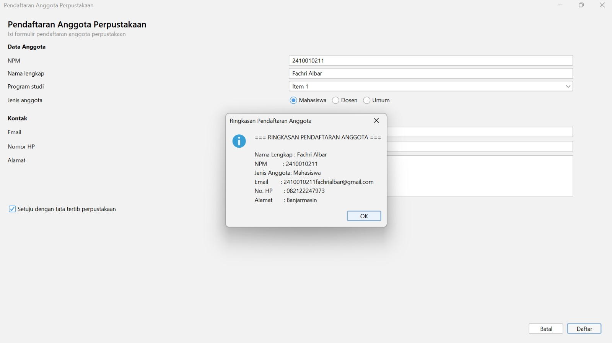
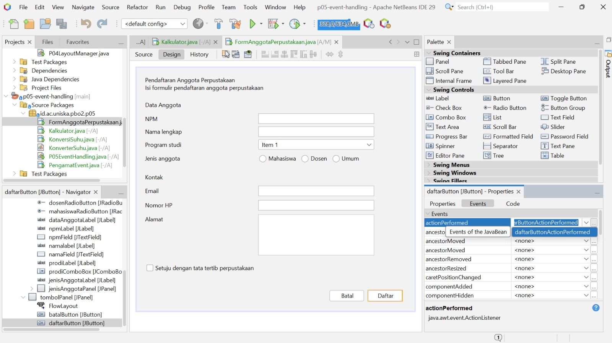
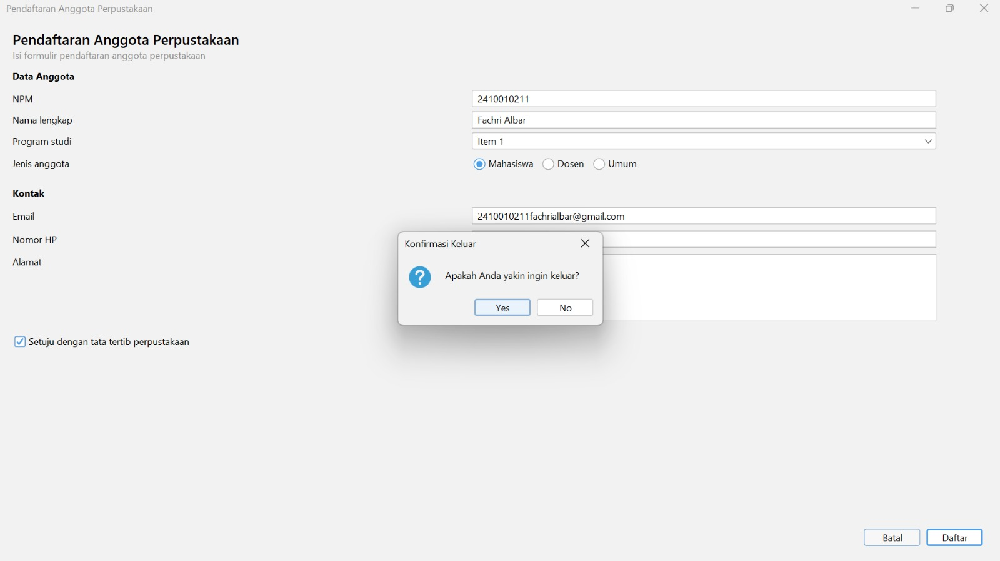

# Laporan Praktikum 05 - Event Handling

* **Nama:** Fachri Albar
* **NPM:** 2410010211
* **Mata Kuliah:** Pemrograman Berorientasi Objek 2

---

## 1. Tabel Pengamatan Praktikum 2 (Konversi Suhu)

| Input Celcius | Tombol Ditekan | Hasil Output | Keterangan / Analisis |
| :--- | :--- | :--- | :--- |
| `0` | Konversi | `32.0 °F` | Titik beku air terkonversi dengan benar. |
| `100` | Konversi | `212.0 °F` | Titik didih air terkonversi dengan presisi. |
| `25` | Konversi | `77.0 °F` | Perhitungan suhu ruangan sesuai rumus (C * 9/5) + 32. |
| `abc` | Konversi | Pesan Error / Validasi | Input teks memicu NumberFormatException sehingga aplikasi menangani error dengan aman. |

---

## 2. Jawaban Eksperimen Praktikum 3 & Praktikum 4

### Praktikum 3 (Kalkulator)
* **Mekanisme Evaluasi Aritmetika:** Evaluasi perhitungan aritmetika pada kalkulator memanfaatkan struktur logika percabangan (`switch-case` atau `if-else`). Saat tombol operator ditekan, angka operan pertama dan jenis operator disimpan ke variabel sementara. Ketika tombol sama dengan (`=`) ditekan, logika perhitungan memproses angka kedua dengan operator yang tersimpan lalu hasilnya ditampilkan ke layar.

### Praktikum 4 (Multiple Listeners & Event Sharing)
* **Multiple Listeners:** Sebuah komponen antarmuka GUI dapat memiliki lebih dari satu listener sekaligus (misalnya `ActionListener` dan `MouseListener`). Tiap listener akan merespons event pemicunya secara terpisah.
* **Event Sharing:** Satu listener yang sama dapat digunakan secara bersama-sama oleh banyak komponen/tombol. Logika pembeda aksi antar tombol dijalankan dengan memeriksa sumber event melalui `evt.getSource()` atau memeriksa teks tombol lewat `evt.getActionCommand()`.

---

## 3. Peta Event pada FormAnggotaPerpustakaan

* **Komponen:** Tombol Daftar (`daftarButton`)
  * **Tipe Event:** `java.awt.event.ActionEvent`
  * **Listener Method:** `daftarButtonActionPerformed(ActionEvent evt)`
  * **Aksi:** Mengambil nilai teks input (NPM, Nama Lengkap, Program Studi, Jenis Anggota, Email, Nomor HP, Alamat), menyusunnya menggunakan `StringBuilder`, lalu memunculkan kotak dialog ringkasan melalui `JOptionPane.showMessageDialog`.
* **Komponen:** Tombol Batal (`batalButton`)
  * **Tipe Event:** `java.awt.event.ActionEvent`
  * **Listener Method:** `batalButtonActionPerformed(ActionEvent evt)`
  * **Aksi:** Memunculkan dialog konfirmasi keluar melalui `JOptionPane.showConfirmDialog`. Jika pengguna memilih opsi `YES_OPTION`, form ditutup menggunakan perintah `dispose()`.

---

## 4. Bukti Hasil Uji Coba

*(Pastikan nama file di bawah ini sama persis dengan nama file gambar yang ada di dalam folder docs)*

### Panel Events Tombol Daftar

### Dialog Ringkasan Pendaftaran

### Dialog Konfirmasi Keluar

---

## 5. Deklarasi Penggunaan AI
Pengembangan tugas ini dibantu oleh AI (Google Gemini) dalam proses penanganan duplikasi event handler pada NetBeans GUI Builder, penyesuaian event listener Swing, serta penyusunan struktur dokumentasi laporan praktikum.