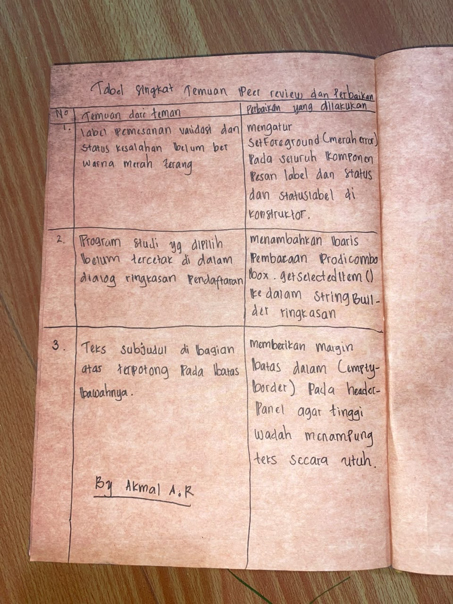
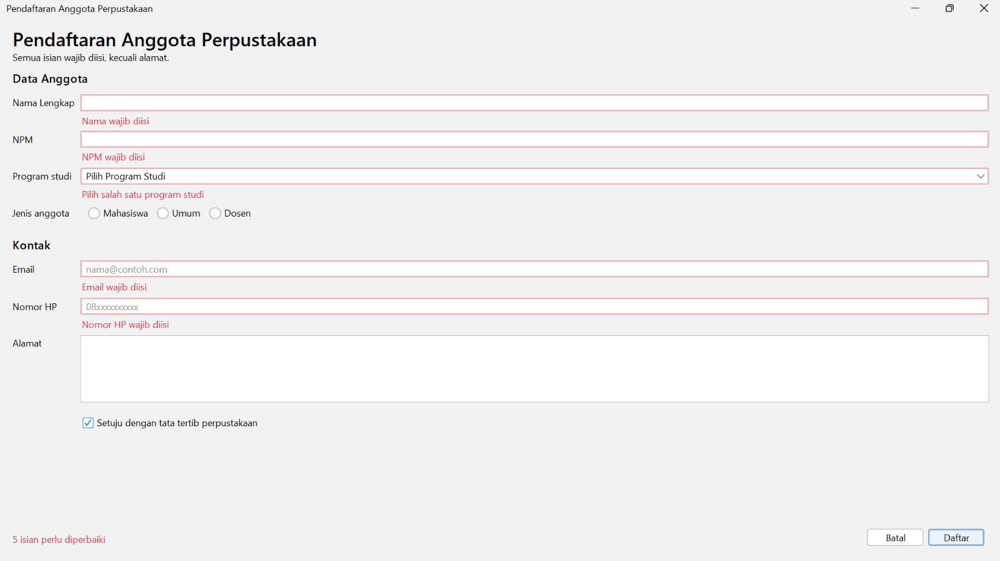
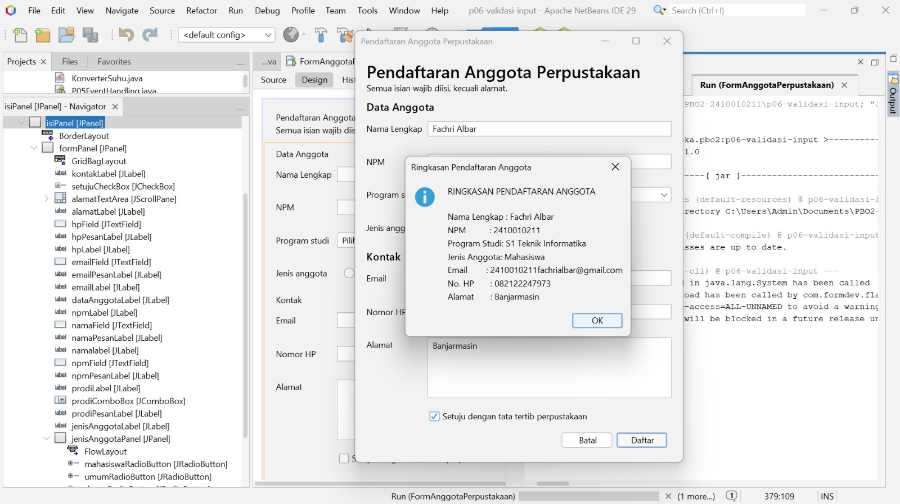
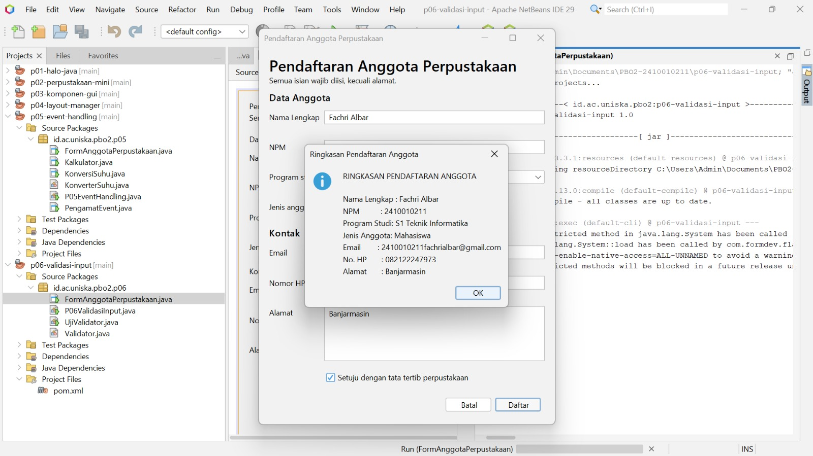

**LAPORAN PRAKTIKUM PEMROGRAMAN BERORIENTASI OBJEK 2**

**Nama			: Fachri Albar **
**NPM			    : 2410010211 **
**Program Studi	: S1 Teknik Informatika **
**Fakultas		: Teknologi Informasi **
**Universitas		: Universitas Islam Kalimantan Muhammad Arsyad Al Banjari **

**Lembar Peer Review Rekan Praktikum**

**Tangkapan Layar Antarmuka dan Panel Komponen & Tampilan Form Saat Validasi Menemukan Kesalahan Input**

 
**Tampilan Struktur Komponen pada Panel Navigator NetBeans**

 **Tampilan Sukses Registrasi dan Dialog Ringkasan**
 
 
**Jawaban dan Analisis Eksperimen Praktikum 4 **

**Fokus Eksperimen:**
Mekanisme validasi input pada pengiriman data (on-submit validation), penanganan status galat, serta pengaturan hierarki layout manager pada form GUI. 

**Hasil dan Analisis**
**Mekanisme Akumulasi Validasi:**
Validasi input dijalankan serentak ketika pengguna menekan tombol Daftar dengan melakukan evaluasi berurutan terhadap seluruh kolom isian. Total kesalahan dihitung menggunakan variabel jumlahKesalahan. Dialog ringkasan pendaftaran hanya dipanggil jika jumlah Kesalahan == 0. Jika masih terdapat kolom yang belum memenuhi syarat, pesan kesalahan spesifik berwarna merah dimunculkan di bawah masing-masing kolom dan status ringkas diperbarui di pojok kiri bawah. 

**Struktur Tata Letak (Layout Management):**
Form memanfaatkan tata letak bertingkat (nested layout). Bagian utama dibagi menggunakan BorderLayout untuk memisahkan judul (NORTH), formulir isian (CENTER), dan tombol aksi (SOUTH). Khusus panel bawah, kombinasi BorderLayout dan FlowLayout digunakan agar label status kesalahan terkunci di sisi kiri bawah sementara tombol kontrol (Batal dan Daftar) berada di sisi kanan bawah tanpa saling bertumpuk.  

**Penanganan Objek GUI:**
Seluruh konfigurasi listener, penataan warna, serta pemanggilan inisialisasiAksiValidasi() wajib diletakkan setelah pemanggilan method initComponents() pada konstruktor. Hal ini memastikan seluruh instans komponen Swing telah selesai dibuat di memori untuk mencegah kemunculan galat NullPointerException. 

**Deklarasi Penggunaan Kecerdasan Buatan (AI)**
Alat yang Digunakan: Google Gemini. 
Keperluan Penggunaan:
Menyempurnakan pembentukan teks StringBuilder agar nilai pilihan program studi dari JComboBox tercetak lengkap pada pesan dialog JOptionPane. 

